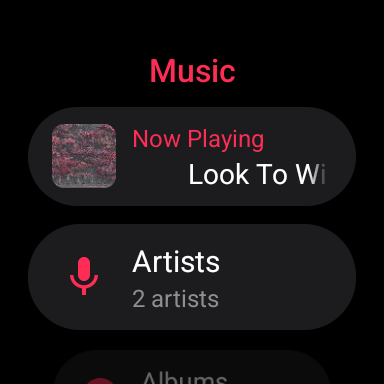
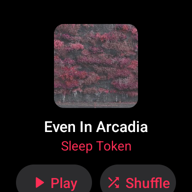
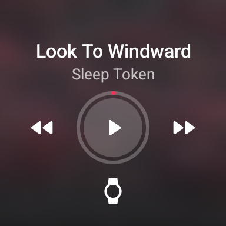
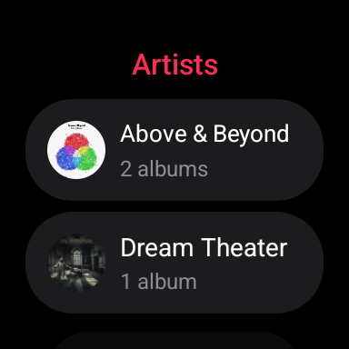

# Pixel Watch Music

An offline music player for Wear OS, for your own music files. Add songs from a browser on your computer or phone
over Wi-Fi, then play them on the watch speaker or Bluetooth headphones. No streaming subscription, no phone app,
no root.

| Music | Album | Now Playing | Artists |
|---|---|---|---|
|  |  |  |  |

- Library by artist, album and song, with album art from your files' tags.
- Now Playing with the cover blurred behind the controls, progress ring, and crown volume.
- Shuffle, album and artist queues, and the watch's own media controls.
- Plays MP3, M4A/AAC, FLAC (up to 24-bit), OGG/Opus and WAV.
- Works with any phone, iPhone included: adding songs only needs a browser.

## Requirements

- A Wear OS 4 or later watch (Android 13+). Only tested on a **Pixel Watch (1st gen) on Wear OS 6**.

## Install

Download `music-player.apk` from the [latest release](../../releases/latest).
Every way of installing uses the watch's **Wireless debugging**:

1. On the watch, **Settings › System › About › Versions**: tap **Build number** 7 times.
2. **Settings › Developer options**: turn on **ADB debugging** and **Wireless debugging**.
3. Have the watch and the installing device on the same Wi-Fi.

Turn Wireless debugging off afterwards; it uses battery.

### From a computer (Windows, macOS, Linux)

Put `music-player.apk` and the install script from the release in one folder, then run:

- Windows: right-click `install.ps1` › **Run with PowerShell**
- macOS / Linux: `bash install.sh`

The script downloads Google's `adb` if you don't have it, walks you through pairing with the watch, and installs
the app.

### From an Android phone

Install an ADB app such as **Bugjaeger** or **Wear Installer 2** from the Play Store, pair it with the watch
(*Wireless debugging › Pair new device*), and install the APK with it.

## Adding music

- Open **Music › Add Music** on the watch. It shows an address and a 4-digit code.
- Open the address in a browser on the same Wi-Fi, enter the code, and drop songs or whole album folders.
  Songs already on the watch are skipped, and you can delete songs from the same page.
- The page only works while Add Music is open, and the code changes every time. After 5 wrong codes the watch
  shows a new one and the page waits 30 seconds. It's plain HTTP on your local network, so use it on Wi-Fi you trust.

## Playing

- Tap a song to play the list it's in; Shuffle is on album, artist and song lists.
- The crown sets the volume.
- The headphones button opens the watch's own output list: connect paired headphones, pair new ones, or switch
  back to the watch speaker. If a Bluetooth speaker or headphones are connected, music plays there.

## Building from source

Plain Java with no Gradle and no AndroidX. You need JDK 17 and the Android SDK with **build-tools 36.0.0** and
**platform android-36.1** (the SDK path comes from `ANDROID_HOME`, or the default Windows location).

```powershell
& .\music-player\build.ps1    # -> music-player\music-player.apk, signed with your debug key
```

Releases are signed with a separate release key: `release.ps1` builds into `dist\`. Pushing a `v*` tag does the same
on GitHub Actions and publishes the release; it needs the `RELEASE_KEYSTORE_B64` and `RELEASE_KEYSTORE_PASS`
repository secrets. Bump `versionCode` in `music-player/AndroidManifest.xml` before each release, or the update won't
install over the previous version.

## License

[MIT](LICENSE)
